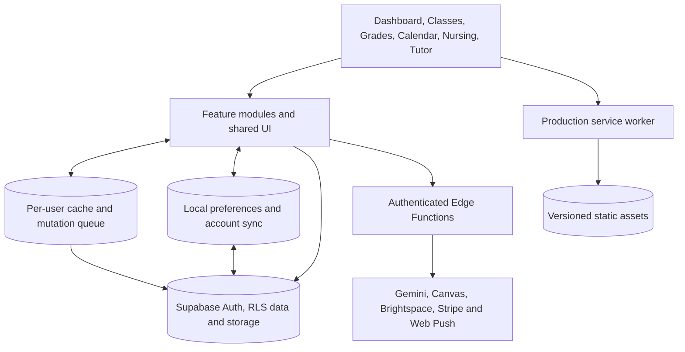

# Architecture & Tech Stack 🏛️

DueVinci is a static multi-page application using native JavaScript ES modules, locally served vendor assets, Supabase services, and a per-user offline planner cache. The application does not need a production bundler to run.

## Architecture

## Frontend

- HTML and vanilla ES modules; `js/app.js` coordinates initialization and bindings.
- Tailwind and browser vendor libraries are served locally and included in the production cache where configured.
- FullCalendar renders the current Month/Week calendar UI.
- PDF.js extracts PDF text; configurable Gemini models process optional syllabus requests server-side.
- Inline SVGs and existing theme CSS preserve the site's visual identity. Degree themes provide accent colors and background artwork.
- Web Audio synthesizes timer alarms and ambient white/brown noise.

## Main modules

| Module | Responsibility |
| --- | --- |
| `academics.js`, `studyPlan.js`, `courseDates.js` | Academic summaries, workload, sequence/deadline planning and date windows |
| `courses.js`, `termRollover.js` | Class/term UI, syllabus import, old-term-preserving class-shell copies |
| `calendar.js` | Calendar UI, date-based `.ics` handling and event-to-assignment conversion |
| `grades.js` | Percentage averages, linear GPA scaling and temporary What-If values |
| `flashcards.js` | Note-derived study content, SM-2 calculations and account-scoped mastery |
| `timers.js`, `studyCalibration.js` | Countdown timers and opt-in Pro duration estimates from completed linked work |
| `nursing.js`, `degreeThemes.js` | Optional fictional Nursing workspace and field themes |
| `tutor.js`, `subscription.js`, `canvas.js`, `brightspace.js`, `lmsAlerts.js` | Pro UI, entitlement snapshots, provider actions and opt-in alerts |
| `ui.js`, `components.js`, `scrollAids.js` | Shared sidebar, Settings/Support, focus, themes and nested-pane aids |
| `auth.js`, `preferences.js`, `offlineDb.js`, `backup.js`, `pwa.js` | Authentication, account preferences, local queue, portability and worker lifecycle |

The repository also contains `supabase/functions/`, `supabase/migrations/`, `tests/`, `docs/`, and the wiki source. See [Developer Guide](Developer-Guide-&-Contributing) for contribution checks.

## Persistence boundaries

- Supabase Auth identifies accounts; owner-scoped RLS protects academic data. There is no general anonymous guest planner sign-in flow.
- IndexedDB/localStorage cache supported free-planner data and queue writes by account. The worker caches static assets, not authenticated API responses.
- Non-sensitive preferences, the optional Nursing workspace, and study settings/history can synchronize through validated account preferences.
- Flashcard mastery has account-scoped local storage and cloud merge. Timers and some UI state remain local; this is not universal realtime state sync.
- Tutor conversation history is current-page memory; the backend stores usage aggregates separately. A selected course adds bounded account-owned course/notes/assignment context to its request.
- Local previews on loopback hosts skip/remove only DueVinci's worker. Hosted production retains installation/offline support.

## Backend and providers

Authenticated Edge Functions handle syllabus/Tutor requests, Canvas/Brightspace connections, billing, support and push-related operations. Privileged keys and encrypted provider connection secrets remain server-side. Model availability, credentials, entitlements, and deployment state affect provider features independently of static page availability.

Canvas imports courses and dated assignments directly for selected courses; optional assignment alerts follow sync, and opted-in accounts can use scheduled refresh and posted-grade alerts. Brightspace is SNHU calendar-only import with user/provider-scoped stale-entry handling. Google and Microsoft calendar OAuth sync is read-only; the first sync follows connection, while later syncs are user-started. Stripe provides subscription checkout/portal/webhook operations.

See the [readiness map](https://github.com/saappleg/DueVinci/blob/main/docs/FEATURE_READINESS.md), [operations guide](https://github.com/saappleg/DueVinci/blob/main/docs/OPERATIONS.md), and [Privacy Policy](https://duevinci.tech/legal/privacy.html). Nursing practice is fictional only; never store patient information.
