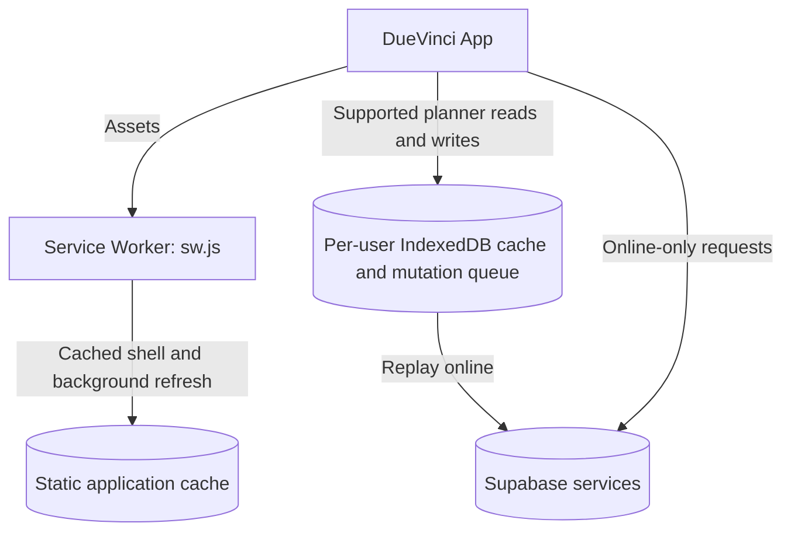

# Offline Support & Progressive Web App (PWA) 📱

DueVinci caches its production application shell and per-user planner data. After an initial online sign-in and successful caching, supported courses, assignments, completion changes, grades, and calendar events can remain available offline. Supported writes queue locally and replay after reconnecting.

Authentication, AI/Tutor, Canvas/Brightspace, billing, support, and account deletion require connectivity. Offline availability depends on what was cached and browser storage remaining available.

## Offline architecture

## Key modules

### Service worker (`sw.js`)

- Precaches known pages, modules, local vendor assets, the generated Tailwind stylesheet, theme styles, and icons. Optional asset failures do not abort the whole install.
- Serves known application navigation from cache with background refresh.
- Versions both application and runtime caches so older modules do not override a new shell after activation.
- Does not cache authenticated Supabase/API responses.

The current release shell is `duevinci-v8.50` as of October 17, 2026; this cache identifier is separate from the application's 2.8 version line.

### PWA controller (`js/modules/pwa.js`)

The controller registers the worker relative to the manifest directory, including from nested routes, and requests worker-script revalidation. It handles the browser install prompt and installation-banner dismissal. Offline status and queued synchronization are coordinated with the planner's persistence modules.

### Local development exception

On `localhost`, `127.0.0.1`, and IPv6 loopback, DueVinci skips worker registration and unregisters only workers matching its manifest-directory `sw.js`. Other applications' workers and planner storage are preserved. An already controlled page may need a reload after cleanup. Use hosted production or an appropriate test environment to check installation/offline behavior; localhost preview is intended to show current source.

## Using the planner offline

1. Sign in and visit required routes while connected.
2. Confirm the needed coursework has loaded before going offline.
3. Make supported free-planner edits; keep pending data on the same device until synchronization completes.
4. Reconnect and allow the queue to replay before relying on another device's copy.

Flashcard mastery also retains account-scoped local changes for later merge. A local cache is not an independent backup. Export a [JSON backup](Data-Backup-&-Cloud-Sync) before a long offline session; browsers can evict storage.

## Installing

- iOS Safari: Share → Add to Home Screen.
- Android Chrome: use Install App or Add to Home Screen when offered.
- Desktop Chrome/Edge: use the browser's install control when offered.

Available install controls vary by browser. Verify a hosted installation and an offline reload manually; source tests and public asset checks do not replace a device check.
