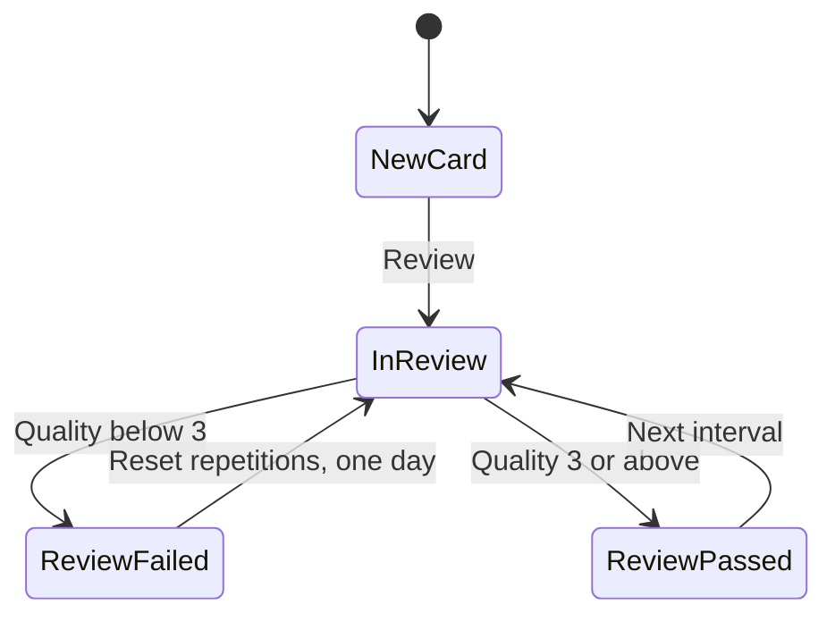

# SM-2 Spaced Repetition & Flashcards 🃏

`js/modules/flashcards.js` builds course study material from the student's notes, calculates SM-2 review intervals, and saves account-scoped mastery. Current generation extracts note concepts locally; it does not call Gemini to generate these decks.

## SM-2 calculation

The pure calculation accepts recall quality from 0 to 5. The UI presents four responses: **Again** (1), **Hard** (3), **Good** (4), and **Easy** (5).

The ease factor starts at 2.5 and is updated as:

$$EF' = EF + (0.1 - (5 - q) \times (0.08 + (5 - q) \times 0.02))$$

Its minimum is 1.3. Failed recall (`q < 3`) resets repetitions and schedules one day. Successful recall schedules one day for the first repetition, six days for the second, and then a rounded previous interval multiplied by the updated ease factor. The resulting date and review state are saved per card.

## Using course study tools

1. Open a class's Scratchpad or Study & Quiz section and supply your own study notes.
2. Generate the spaced deck/practice quiz using the existing controls.
3. Flip cards with **Flip Card**, use Previous/Next, and select a recall response.
4. Use the optional read-aloud control or export the current deck as CSV for compatible tools.

The current UI does not implement a separate deck/tag manager, global number-key recall shortcuts, retention charts, or Anki `.apkg` import/export. Native buttons remain keyboard-activatable; this is different from global hotkey support.

## Saving and portability

Mastery is scoped to the signed-in account and course. Local review changes are retained for later cloud merge; per-card timestamps resolve review-state updates. Backups include the current account's available local/cloud mastery. Older unscoped progress is not automatically assigned to whichever account signs in next.

See [Data Backup & Cloud Sync](Data-Backup-&-Cloud-Sync) and [Offline Support & PWA](Offline-Support-&-PWA). Cross-device behavior needs verification with actual accounts; static algorithm tests do not prove a complete synchronization session.

Nursing Hub has its own documented workspace/review tools. All nursing study content must be fictional and contain no real patient information.
