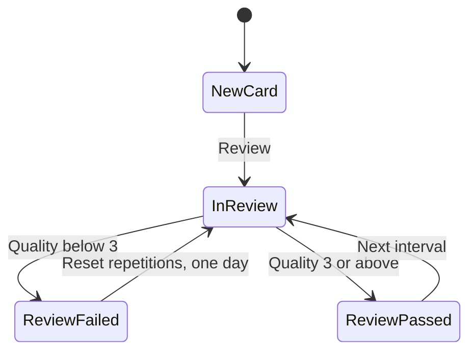

# SM-2 Spaced Repetition & Flashcards 🃏

`js/modules/flashcards.js` builds course study material from the student's notes, calculates SM-2 review intervals, and saves account-scoped mastery. Current generation extracts note concepts locally; it does not call Gemini to generate these decks.

## SM-2 calculation

The pure calculation accepts recall quality from 0 to 5. The UI presents four responses: **Again** (1), **Hard** (3), **Good** (4), and **Easy** (5).

The ease factor starts at 2.5 and is updated as:

$$EF' = EF + (0.1 - (5 - q) \times (0.08 + (5 - q) \times 0.02))$$

Its minimum is 1.3. Failed recall (`q < 3`) resets repetitions and schedules one day. Successful recall schedules one day for the first repetition, six days for the second, and then a rounded previous interval multiplied by the updated ease factor. The resulting date and review state are saved per card.

## Using course study tools

1. Open a class's Scratchpad or Study & Quiz section and supply your own study notes.
2. Generate the spaced deck/practice quiz using the existing controls.
3. Flip cards with **Flip Card**, use Previous/Next, and select a recall response.
4. Open **Timed Mock Exam** to choose a question count and time limit. The exam uses only questions whose four answer choices are all drawn from your notes; it needs at least four distinct note definitions. Answers stay hidden until you finish or the timer expires. Unanswered questions count as incorrect, then the review shows your choice, the note answer, and its explanation.
5. Use the optional read-aloud control, export the current deck as CSV, or choose **Anki text** for an Anki-importable tab-separated file.

During a mock exam, the question buttons support keyboard focus, **←/→** moves between questions, and **1–4** selects an answer. These shortcuts are active only while an exam is running. Canceling discards the attempt; after the result, choose **Set up another exam** to reset and configure a new one. The timer keeps running if you switch to another study mode.

## Anki text exchange

The flashcard toolbar supports two-way exchange of the term and definition fields through text files. **Anki text** exports a UTF-8 tab-separated file with Anki's `#separator`, `#columns`, and `#deck` headers. In Anki, use **File → Import** and select that `.txt` file. Anki 2.1.54 and later recognize these text import headers; on older Anki versions, import the tab-separated file and map its first two columns to the note fields. See Anki's [text import documentation](https://docs.ankiweb.net/importing/text-files.html).

To import into DueVinci, open the target course, generate or open its flashcard deck, then choose **Import** and select a `.txt`, `.tsv`, or `.csv` file up to 2 MB. The importer reads Front/Back, Term/Definition, Question/Answer, or Prompt/Response columns. It can ignore GUID, tags, deck, and note-type columns when the file identifies them with Anki's column headers. Imports are limited to 500 usable cards and 5,000 characters per front or back. Blank or oversized rows are skipped and counted. Repeated fronts with the same definition are skipped as duplicates. A changed definition updates an existing imported card while preserving its review interval; a front that conflicts with a note-generated card is left unchanged and counted as a conflict. The import status reports additions, updates, duplicates, conflicts, and invalid rows.

Imported content is stored with the course's account-scoped flashcard mastery and follows the existing local backup and cloud sync paths. The separate **CSV** button continues to produce a plain two-column CSV file.

DueVinci does not read or create `.apkg` or `.colpkg` packages. It also does not transfer Anki media, audio, note types/templates, tags, scheduling, or review history; only two text fields are exchanged. Packaged decks include collection and media data that this browser app does not process. See Anki's [export documentation](https://docs.ankiweb.net/exporting.html) for its packaged formats. The app also does not implement a separate deck/tag manager, flashcard-wide number-key shortcuts, or retention charts. Native buttons remain keyboard-activatable; this is different from global flashcard hotkey support.

## Saving and portability

Mastery is scoped to the signed-in account and course. Local review changes are retained for later cloud merge; per-card timestamps resolve review-state updates. Backups include the current account's available local/cloud mastery. Older unscoped progress is not automatically assigned to whichever account signs in next.

See [Data Backup & Cloud Sync](Data-Backup-&-Cloud-Sync) and [Offline Support & PWA](Offline-Support-&-PWA). Cross-device behavior needs verification with actual accounts; static algorithm tests do not prove a complete synchronization session.

Nursing Hub has its own documented workspace/review tools. All nursing study content must be fictional and contain no real patient information.
